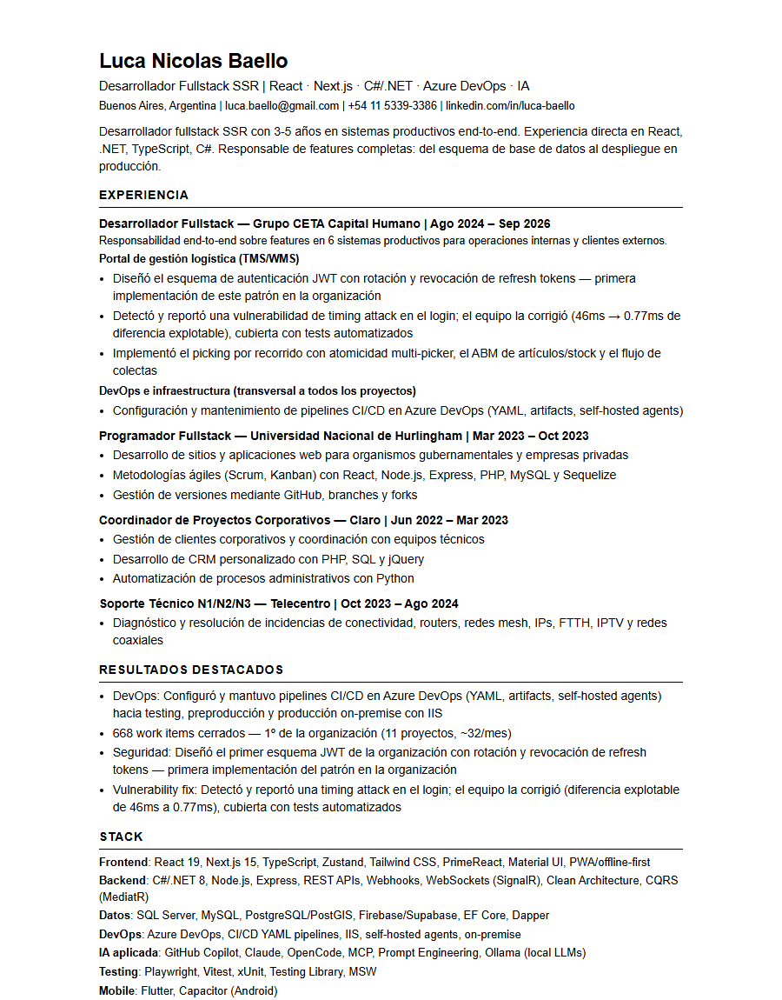
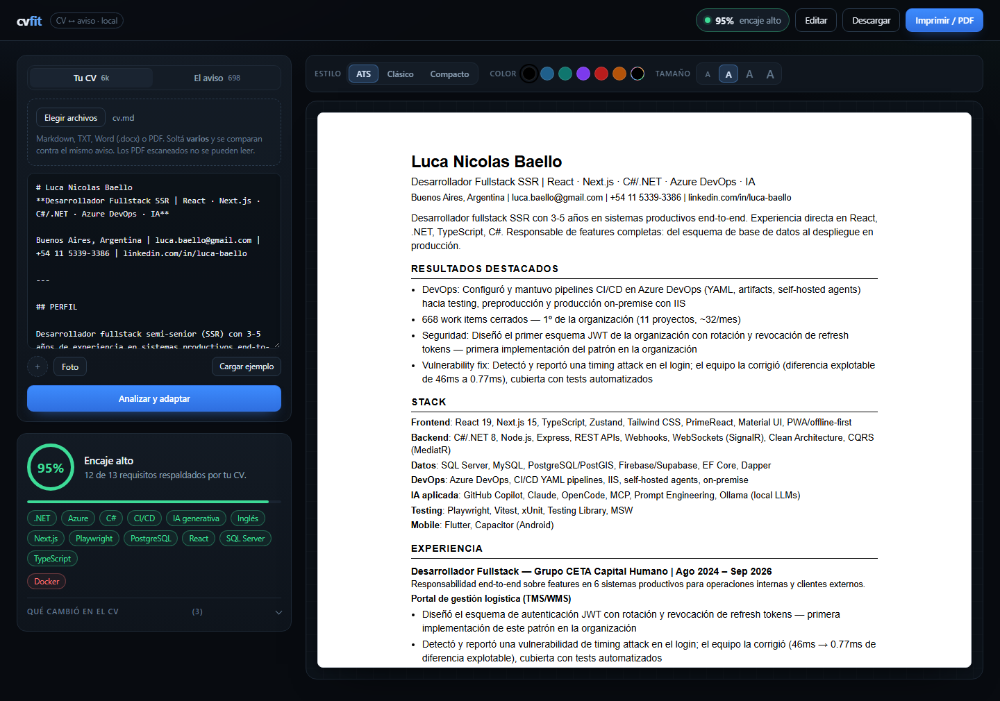
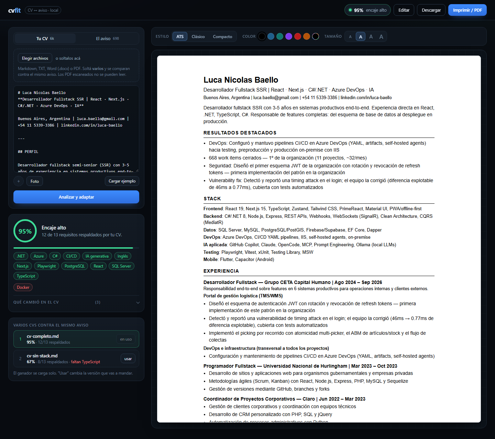
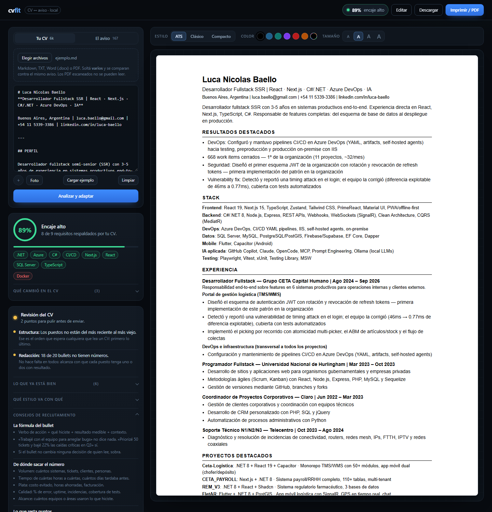

# cvfit

**Arrastrás tu CV (PDF, Word o Markdown) y pegás el aviso. Te dice cuánto de ese aviso podés
respaldar, qué te falta, qué arreglaría un reclutador en tu CV, y te devuelve el CV adaptado en
PDF — sin inventar una sola línea.**

Corre local: tu CV no sale de tu máquina.

## Instalación

```bash
pipx install git+https://github.com/lucabaello1998/cvfit
```

Sin dependencias: alcanza Python 3.11 o más (y Chrome o Edge instalado si querés el PDF directo).
Quedan dos comandos: `cvfit` para la consola y `cvfit-servidor` para la interfaz. Si vas a tocar el
código, `python -m pip install -e ".[dev]"` agrega además `pytest` y `ruff`.



## El problema

Adaptar el CV a cada aviso a mano cuesta 40 minutos y se hace mal: se agregan las palabras del
aviso aunque no haya evidencia, y el reclutador lo detecta en la entrevista.

Y al revés: se postula a 30 búsquedas sin saber que en 20 el requisito excluyente ya te dejó afuera.

## Qué hace

```
CV.pdf|.docx|.md  +  aviso.txt  →  cobertura  →  gaps  →  revisión  →  CV adaptado en 3 estilos
```

| Salida | Qué es |
|---|---|
| **Cobertura** | % de requisitos del aviso que tu CV ya menciona, ponderado: los excluyentes pesan 3× |
| **Gaps** | Lo que el aviso pide y el CV no respalda, separado en excluyentes y deseables |
| **Observaciones** | Lo que no es tecnología pero decide: años, inglés, modalidad, seniority |
| **Revisión** | Lo que un reclutador marcaría antes de que lo mandes: estructura, fechas, redacción y formato |
| **CV adaptado** | Reordenado por relevancia, con resumen reescrito y recorte de bullets |
| **Estilos** | `ats` (una columna, sin tablas), `clasico` (una columna con acento), `compacto` (dos columnas) |
| **Retoques** | Foto de perfil, color de acento, tamaño de letra y edición directa antes de descargar |
| **PDF** | Sale listo para mandar: lo imprime el Chrome o el Edge que ya tenés |

¿Tenés varias versiones del CV? Se sueltan juntas contra el mismo aviso y sale el ranking de cuál
encaja mejor — ver [Varios CVs contra el mismo aviso](#varios-cvs-contra-el-mismo-aviso).

### La regla que lo hace distinto

Adaptar es **reordenar y resaltar**, no maquillar. Todo texto generado se valida contra el CV
original: si el resumen propuesto menciona una tecnología que el CV no declara, el resumen se
descarta y queda el original. El campo `sin_respaldo` lista lo que el aviso pide y el CV no puede
sostener, para que decidas vos si es un gap real o algo que omitiste.

No hay LLM en el camino crítico: son reglas explícitas y auditables. Cada punto se puede discutir.

## Uso

### Con interfaz

```bash
cvfit-servidor        # http://localhost:8765
```

Desde un clon sin instalar es lo mismo con `python -m cvfit.servidor`.

Arrastrás el CV a la zona de archivo (**Markdown, TXT, Word `.docx` o PDF**) o lo pegás como texto en
la pestaña **Tu CV**, pegás el aviso en **El aviso** y ves el puntaje, los gaps y la previsualización
del CV adaptado.



- **Barra superior**: el encaje queda siempre a la vista y las acciones (*Editar*, *Descargar*,
  *Imprimir / PDF*) trabajan sobre la hoja tal como la ves. Hasta que hay un CV están deshabilitadas.
- **Pestañas**: *Tu CV* y *El aviso*, cada una con su contador de caracteres — no hay que scrollear
  dos textareas enormes para llegar al botón.
- **Resultado**: anillo con el porcentaje, barra de progreso y chips verdes de lo respaldado contra
  chips rojos de los gaps. *Observaciones* y *Qué cambió en el CV* se despliegan con el detalle.
- **Revisión**: semáforo, hallazgos con qué hacer en cada uno, reescrituras sugeridas, lo que ya está
  bien, qué estilo conviene y consejos de reclutamiento. Se actualiza mientras escribís.
- **Barra de diseño**: estilo, muestras de color y tamaño de letra, con la previsualización
  actualizándose al toque. La hoja queda sticky mientras scrolleás.
- **Sesión**: CV, aviso, estilo, color, foto y tamaño quedan guardados en el navegador; un refresco
  no borra lo pegado. *Limpiar* arranca de cero y borra lo guardado.
- **Atajos**: `Ctrl` + `Enter` (`Cmd` + `Enter` en Mac) analiza sin soltar el teclado.
- **Feedback**: cada acción avisa con un toast abajo; si falta el CV o el aviso, te abre la pestaña
  que corresponde en vez de fallar en silencio.

La extracción de `.docx` y `.pdf` la hace el propio programa con la biblioteca estándar: `zipfile` +
XML para Word, y descompresión de streams + mapa `ToUnicode` para PDF. No hay dependencias ni
servicio externo, así que el CV tampoco sale de la máquina al subirlo.

### Varios CVs contra el mismo aviso

Si tenés dos o tres versiones del CV (una de una página, otra con métricas, la que declara
TypeScript), no hace falta analizarlas de a una: se comparan y queda el ranking.

```bash
python -m cvfit.analizar --cv CV_1pagina.pdf CV_metricas.pdf CV_viejo.md \
  --aviso aviso.txt --salida cv.html
```

```
comparando 3 CVs contra el mismo aviso

 #  CV                                      encaje  respaldados  gaps excluyentes
---------------------------------------------------------------------------------
 1  CV_Luca_Baello_Fullstack_2Paginas.pdf     100%        13/13  —
 2  CV_Luca_Baello_2026_ACTUALIZADO.md         95%        12/13  —
 3  CV_Luca_Baello.pdf                         67%         8/13  TypeScript

gana: CV_Luca_Baello_Fullstack_2Paginas.pdf
```

En la interfaz es lo mismo: soltás varios archivos juntos en la zona de carga y aparece el ranking con
un botón **usar** por fila. El ganador se carga solo, así lo que ves en la previsualización es la
versión que vas a mandar; con "usar" cambiás de versión sin volver a subir nada.



El orden es: más cobertura ponderada, después menos gaps **excluyentes**, después más requisitos
cubiertos. El mismo aviso se evalúa igual para todos, así que la comparación es honesta. Un archivo
ilegible se saltea con el motivo en vez de tumbar la corrida.

### Por consola

```bash
cvfit --cv ejemplos/cv.md --aviso ejemplos/aviso.txt --estilo ats --salida cv.pdf
cvfit --cv ~/Downloads/CV.pdf --aviso aviso.txt --estilo ats --salida cv.pdf

# con retoques
cvfit --cv CV.pdf --aviso aviso.txt --estilo clasico \
  --foto ~/fotos/perfil.jpg --acento "#0f766e" --escala 1.1 --salida cv.pdf
```

Desde un clon sin instalar, cambiá `cvfit` por `python -m cvfit.analizar`.

```
94% — Encaje alto: podés respaldar casi todo lo que pide el aviso.

respaldados (12/13): .NET, Azure, C#, CI/CD, IA generativa, Inglés, Next.js, Playwright, ...
deseables que faltan:   Docker

distinto en el CV:
  · resumen reescrito con React, .NET, TypeScript, C#
  · RESULTADOS DESTACADOS: 7 → 4 bullets
  · Desarrollador Fullstack — Grupo CETA: 13 → 4 bullets

revisión del CV — hay cosas para pulir
   ! [estructura] Los puestos no están del más reciente al más viejo.
       Ese es el orden que espera cualquiera que lea un CV: primero lo último.
   ! [redaccion] 18 de 20 bullets no tienen números.
       No hace falta en todos: alcanza con que cada puesto tenga uno o dos con resultado.

  ya está bien:
    · El contacto está completo.
    · 2 de 20 bullets tienen números (10%).

escrito: cv.pdf  (estilo ats, PDF)
```

`--salida cv.pdf` imprime con el Chrome o el Edge que ya tenés. Si no encuentra ninguno, avisa y
escribe `cv.html` en su lugar: se abre y se imprime desde el navegador, sin perder nada.

## Revisión del CV

Antes de adaptar nada, cvfit marca lo que un reclutador ve en el primer minuto: contacto incompleto,
puestos sin fechas, huecos o solapamientos, bullets sin números, primera persona, adjetivos de
relleno, títulos de sección inconsistentes y foto o edad en un CV que va a un ATS.



Cada hallazgo trae **qué hacer**, ordenado por gravedad:

| Color | Significado |
|---|---|
| 🟢 verde | No hay nada grave: está listo para mandar |
| 🟡 amarillo | Hay cosas para pulir antes de enviar |
| 🔴 rojo | Algo que un filtro o un reclutador puede usar para descartarte |

Cuando el problema es cómo arranca un bullet, propone una reescritura **con las palabras que ya
están en tu CV**:

| En el CV | Sugerencia |
|---|---|
| Responsable del equipo de frontend | Lideré el equipo de frontend |
| Participé en la migración a la nube | Ejecuté la migración a la nube |
| Colaboré en el equipo de frontend | Formé parte del equipo de frontend |
| Ayudé a los nuevos ingresos | Acompañé a los nuevos ingresos |

**No hay modelo de lenguaje.** Son reglas deterministas sobre el texto, así que la revisión no puede
inventar un logro, un número ni una tecnología. Cuando falta la métrica, deja el lugar para que la
completes vos: la sugerencia cambia el verbo, no la experiencia.

El panel también incluye una guía de estilos (cuándo conviene ATS, Clásico o Compacto) y consejos
de reclutamiento con la fórmula del bullet, de dónde sacar el número, qué resta puntos y qué revisar
antes de apretar enviar.

### De dónde salen los consejos

No son opiniones sueltas: están tomados de guías públicas de reclutamiento y campus de carrera.

- [Harvard FAS — Create a Strong Resume](https://careerservices.fas.harvard.edu/resources/create-a-strong-resume/):
  voz activa, sin pronombres, resultados cuantificados, sin foto ni edad, orden reverse-chronological.
- [Indeed — Chronological vs. functional resume](https://www.indeed.com/career-advice/resumes-cover-letters/chronological-vs-functional-resume):
  el cronológico es el default; el funcional solo cuando hay huecos o cambio de rubro.
- [Jobscan — ATS resume](https://www.jobscan.co/blog/ats-resume/):
  una columna, títulos estándar y palabras clave del aviso (la mayoría de los reclutadores filtra
  por palabra clave antes de leer).

### Lo que la revisión no hace

- No corrige ortografía: no hay diccionario, solo reglas de forma.
- No reescribe párrafos enteros ni "mejora" el tono: eso requiere entender el contexto y acá se
  prefiere no adivinar.
- No reemplaza a alguien que lea el CV. Marca lo objetivo; el criterio sigue siendo tuyo.

## Foto, color y edición

El CV adaptado no es un PDF cerrado: se puede terminar de ajustar antes de mandarlo.

| Retoque | Interfaz | Consola |
|---|---|---|
| **Foto de perfil** | subís la imagen y aparece en el encabezado (miniatura y avatar incluidos); se incrusta como data URI | `--foto perfil.jpg` |
| **Color de acento** | seis muestras + selector libre | `--acento "#0f766e"` |
| **Tamaño de letra** | segmentado `A A A A` (0,9 a 1,2) | `--escala 1.1` |
| **Edición fina** | botón *Editar*: se toca el texto en la previsualización y se escribe ahí | — |
| **Descarga** | *Descargar* genera el PDF con lo editado; si no hay navegador, baja el `.html` y avisa | `--salida cv.pdf` |

La foto se lee en el navegador y se incrusta en el HTML: no se sube a ningún servidor, igual que el
resto del CV. Se aceptan `png`, `jpg` y `webp`, hasta 2 MB; el resto se descarta.

El PDF lo imprime el Chrome o el Edge que ya está instalado, en modo headless, con `--print-to-pdf`.
No hay servicios externos ni dependencias: si la ruta no es la habitual, `CVFIT_NAVEGADOR` la fuerza.

Detalles que sí importan:

- Sin foto ni color, el estilo ATS sale exactamente como antes: una columna, negro, sin adornos.
- En ATS la foto va en escala de grises y recortada en cuadrado; los filtros leen texto, así que la
  foto y el color no suman (y a veces restan). La interfaz lo dice.
- El color es un hex validado (`#rrggbb`); cualquier otra cosa se ignora en vez de inyectarse en el CSS.
- La edición es directa sobre el HTML: lo que queda en la previsualización es lo que se imprime y se
  descarga. Si cambiás de estilo, color o volvés a analizar, el CV se regenera y la edición se pierde.
- El nombre del PDF sale del `# Nombre` del CV (`CV_Luca_Nicolas_Baello.pdf`), sin acentos ni espacios,
  porque los portales suelen romperlos.

## El CV de entrada

Un archivo `.md`, `.txt`, `.docx` o `.pdf` — el formato que ya tengas. En Markdown:

```markdown
# Nombre Apellido
**Título | Stack**

Ciudad | email | teléfono

## EXPERIENCIA

### Puesto — Empresa | 2024 – 2026
- Logro con número
- Otro logro

## STACK

| Área | Tecnologías |
|---|---|
| Backend | C#/.NET, PostgreSQL |
```

H2 = sección, H3 = puesto, `-` = bullet, tablas de dos columnas = stack o proyectos. Las líneas en
negrita dentro de un puesto abren un subtítulo, así los bullets quedan debajo y no sueltos.

## Qué NO hace

- **No dice si entrás.** Ninguna herramienta puede. Dice cuánto del aviso podés respaldar y qué te
  falta; la decisión es de quien te entrevista.
- No inventa experiencia, ni títulos, ni años, ni idiomas.
- No postula. Para eso está [job-radar](https://github.com/lucabaello1998/job-radar), que encuentra
  y escribe el mensaje; la postulación la apretás vos.
- No traduce el CV. Si el aviso está en inglés, el CV tiene que estar en inglés antes de entrar.

## Límites de la extracción de PDF

El PDF es el formato más hostil que existe. Acá se lee con la biblioteca estándar y sin OCR:

| Caso | Qué pasa |
|---|---|
| PDF exportado desde Word / Google Docs / LaTeX | Funciona: se leen los `ToUnicode` de cada fuente |
| PDF con fuentes sin mapa de caracteres | **Se rechaza con un mensaje claro** en vez de devolver texto basura |
| PDF escaneado (una foto) | Se rechaza: no hay texto, haría falta OCR |
| PDF a dos columnas | El texto sale, pero las columnas se intercalan por renglón: revisalo en el textarea |
| PDF con contraseña | Se rechaza |

Un PDF no escribe líneas, escribe bloques sueltos: un cambio de negrita, un bullet o una palabra en
otro color es un bloque nuevo con su propia posición. Por eso el texto se reconstruye **por
coordenadas**: todo lo que comparte altura se une de izquierda a derecha, y los renglones cortados
por el ancho de la página se vuelven a pegar. Sin eso sale una palabra por renglón.

La regla es la misma que en el resto del proyecto: si no se puede leer, se dice. Nunca se adivina.
Un `.docx` exportado desde Word es la opción más confiable para un CV con diseño.

## Tests

```bash
python -m pytest -q      # 105 tests
```

Cubren el parser, la detección de requisitos (incluidos los falsos positivos típicos: "reactiva" no
es React, "go" no es Go), el encaje, la regla anti-invención, que la plantilla ATS no emita tablas
ni grillas, y la extracción de archivos con un `.docx` y PDFs armados a mano en el propio test —
incluido el caso de un PDF que escribe cada palabra en un bloque aparte. La revisión tiene los suyos:
contacto incompleto, fechas faltantes, huecos y solapamientos, orden invertido, bullets sin números,
primera persona, relleno, edad/DNI, y cada reescritura comparada contra el texto exacto que debería
salir. El PDF se prueba con un navegador simulado (comando, banderas, timeout, salida inválida) y una
vez de verdad, con `skip` si la máquina no tiene Chrome ni Edge. Los endpoints del servidor se
levantan en un puerto libre y se llaman como lo haría la interfaz: revisión con y sin CV, PDF con
nombre saneado, caída sin navegador y 404. La comparación de varios CVs mantiene los suyos: orden,
desempate, un archivo ilegible que no tumba la corrida y el ganador escrito por la CLI. Los retoques
también: que una foto que no es imagen se descarte, que un color inválido no llegue al CSS y que la
escala se recorte a un rango usable.

Las capturas del README se regeneran con `python captura.py`: levanta la app con el CV de ejemplo,
calcula el estado con el motor real y la fotografía con Chrome headless.

## Licencia

MIT.
